<h1 align="center">
  <br>
  apic
</h1>

<p align="center"><strong>apic is epic</strong>: run API requests from plain <code>.http</code> files, in the terminal, in CI, or from an AI agent, on any platform, with one static binary.</p>

<div align="center">

[](https://github.com/hungovercoders/apic/actions/workflows/ci.yml) [](https://apic.sh/) [](https://github.com/hungovercoders/apic/releases/latest)  [](LICENSE)

</div>

<p align="center"></p>

```sh
apic demo                           # terminal 1: a fake API and a project for it in ./apic-demo
cd apic-demo                        # terminal 2
apic run login                      # POST, capture the token
apic run whoami                     # reuse the token, check assertions
apic run auth.http --json | jq      # a file as a flow, one JSON line per request
apic test                           # Gherkin features against the same requests
claude mcp add api -- apic mcp      # an agent calls the same requests as tools
apic ui --demo                      # or just the UI on the fake API, no project
```

## Install

```sh
brew install hungovercoders/tap/apic                              # macOS / Linux
go install github.com/hungovercoders/apic/cmd/apic@latest         # Go 1.25+
curl -fsSL https://raw.githubusercontent.com/hungovercoders/apic/main/install.sh | sh
irm https://raw.githubusercontent.com/hungovercoders/apic/main/install.ps1 | iex   # Windows
```

Packages, the Docker image and the GitHub Action:
[getting started](https://apic.sh/getting-started/).

## Documentation

Everything is on **[apic.sh](https://apic.sh/)**: [getting started](https://apic.sh/getting-started/),
[the course](https://apic.sh/learn/), the [CLI reference](https://apic.sh/cli/),
the [`.http` format](https://apic.sh/format/) and [authentication](https://apic.sh/auth/).

## Contributing

Read [CONTRIBUTING.md](CONTRIBUTING.md) first, [AGENTS.md](AGENTS.md) if you
are an AI agent, and [docs/README.md](docs/README.md) for the routing table for
every doc in this repo. Report a credential that escapes privately
([SECURITY.md](SECURITY.md)).

## Pipeline status

[](https://slopstopper.dev/)

### 🔒 Security
[](https://github.com/hungovercoders/apic/actions/workflows/ss-security-dast-check.yml)
[](https://github.com/hungovercoders/apic/actions/workflows/ss-security-sast-check.yml)
[](https://github.com/hungovercoders/apic/actions/workflows/ss-security-secrets-check.yml)
[](https://github.com/hungovercoders/apic/actions/workflows/ss-security-vulnerability-all-check.yml)
[](https://github.com/hungovercoders/apic/actions/workflows/ss-security-vulnerability-new-check.yml)

### 🧹 Hygiene
[](https://github.com/hungovercoders/apic/actions/workflows/ss-hygiene-auto-label-pr.yml)
[](https://github.com/hungovercoders/apic/actions/workflows/ss-hygiene-complexity-check.yml)
[](https://github.com/hungovercoders/apic/actions/workflows/ss-hygiene-csp-exceptions-check.yml)
[](https://github.com/hungovercoders/apic/actions/workflows/ss-hygiene-docs-accuracy-check.yml)
[](https://github.com/hungovercoders/apic/actions/workflows/ss-hygiene-docs-size-check.yml)
[](https://github.com/hungovercoders/apic/actions/workflows/ss-hygiene-docs-structure-check.yml)
[](https://github.com/hungovercoders/apic/actions/workflows/ss-hygiene-entry-files-check.yml)

### ✅ Reliability
[](https://github.com/hungovercoders/apic/actions/workflows/ss-reliability-accessibility-check.yml)
[](https://github.com/hungovercoders/apic/actions/workflows/ss-reliability-broken-links-check.yml)
[](https://github.com/hungovercoders/apic/actions/workflows/ss-reliability-core-web-vitals.yml)
[](https://github.com/hungovercoders/apic/actions/workflows/ss-reliability-e2e-check.yml)
[](https://github.com/hungovercoders/apic/actions/workflows/ss-reliability-llms-txt-check.yml)
[](https://github.com/hungovercoders/apic/actions/workflows/ss-reliability-robots-txt-check.yml)
[](https://github.com/hungovercoders/apic/actions/workflows/ss-reliability-seo-check.yml)
[](https://github.com/hungovercoders/apic/actions/workflows/ss-reliability-sitemap-check.yml)
[](https://github.com/hungovercoders/apic/actions/workflows/ss-reliability-smoke-tests.yml)

### 🤖 Operational
[](https://github.com/hungovercoders/apic/actions/workflows/ss-cloudflare-deployed.yml)
[](https://github.com/hungovercoders/apic/actions/workflows/ss-workflow-failure-issue.yml)

## Licence

[MIT](LICENSE); every release archive ships the notices for the modules the
binary links.
